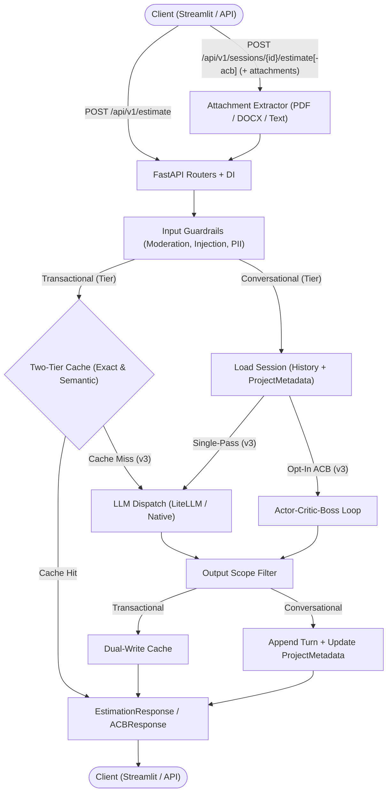
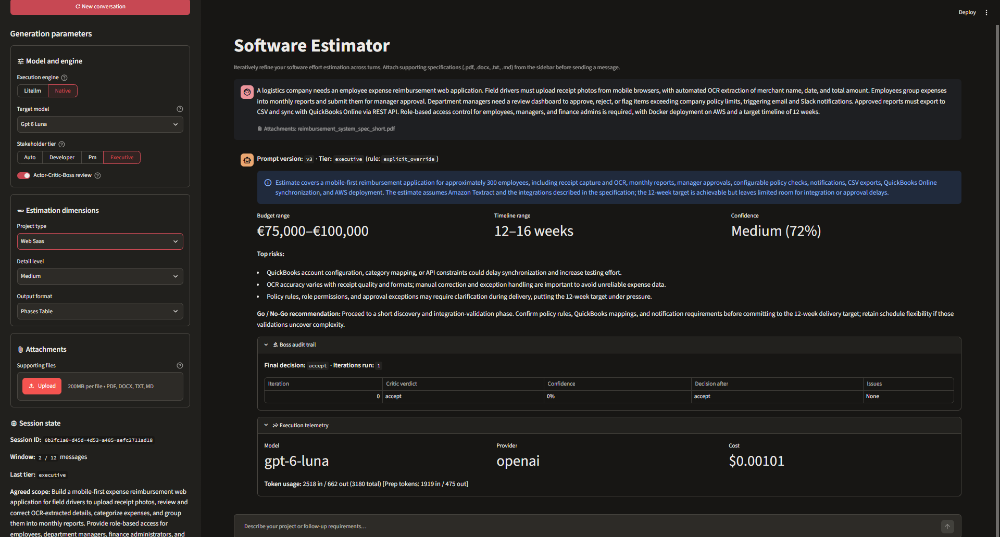

# AIE Estimator

Monorepo for **AIE Estimator**: a Python FastAPI backend for automated software engineering effort estimation using Context-Augmented Generation (CAG) (paired with a Streamlit conversational UI), structured alongside a dedicated `frontend/` workspace for the upcoming web client.

## About

Personal repository following the [LIDR AI Engineering program](https://lidr.notion.site/ai-engineering), exploring production Generative AI: Context-Augmented Generation (CAG), multi-provider LLM routing, guardrails, semantic caching, offline corpus ingestion, and observability with Python, FastAPI, and leading LLMs.

## Overview

AIE Estimator processes software project descriptions and domain parameters (`project_type`, `detail_level`, `output_format`) to produce structured effort estimates—task phases, durations, EUR costs, and confidence scores. Historical reference estimations are injected into versioned Jinja2 system prompts as few-shot CAG context, while offline ingestion prepares audited, GDPR-pseudonymized historical budgets for RAG.

## Architecture

- **Domain** ([`backend/src/aie_estimator/domain/`](backend/src/aie_estimator/domain/)): Core estimation orchestration (`estimations_service.py`, `exceptions.py`) and Pydantic v2 contracts (`schemas/`).
- **Foundation** ([`backend/src/aie_estimator/foundation/`](backend/src/aie_estimator/foundation/)): Shared infrastructure—attachments (`attachments/`), guardrails (`guardrails/`), multi-provider LLM dispatch (`llm/`), PostgreSQL persistence (`persistence/`), and versioned Jinja2 templates (`prompts/`).
- **Generation** ([`backend/src/aie_estimator/generation/`](backend/src/aie_estimator/generation/)): Actor-Critic-Boss orchestration (`agentic/`), two-tier Redis caching (`cag/`), conversational session state (`conversation/`), and async RAG embeddings (`rag/`).
- **API** ([`backend/src/aie_estimator/api/`](backend/src/aie_estimator/api/)): FastAPI HTTP routes (`POST /api/v1/estimate`, `POST /api/v1/sessions`, `GET /api/v1/sessions/{session_id}`, `POST /api/v1/sessions/{session_id}/estimate`, `POST /api/v1/sessions/{session_id}/estimate-acb`, `POST /api/v1/ingestion/runs`, `GET /api/v1/ingestion/jobs/{job_id}`, `GET /health`, `GET /`).
- **Ingestion** ([`backend/src/aie_estimator/ingestion/`](backend/src/aie_estimator/ingestion/)): Offline corpus ingestion package (`catalog/`, `documents/`, `loaders/`, `parsers/`, `cleaning/`, `normalizers/`, `pii/`, `orchestrator.py`, `inspect_budgets.py`) separated from the latency-bound online CAG estimation path.
- **Configuration & Composition** ([`settings.py`](backend/src/aie_estimator/settings.py), [`dependencies.py`](backend/src/aie_estimator/dependencies.py), [`server.py`](backend/src/aie_estimator/server.py)): `pydantic-settings` environment management, cached dependency injection factories, and FastAPI application factory (`create_app`).
- **Streamlit UI** ([`backend/streamlit_app.py`](backend/streamlit_app.py)): Session-only conversational Streamlit chat UI with tier selector, opt-in ACB review + `BossTrace` viewer, multi-file upload, sidebar `ProjectMetadata` inspection, and telemetry viewer.

### Context-Augmented Generation (CAG) Workflow



## Project Structure

```
aie-estimator/
├── auto/                               # Root automation scripts (dc.cmd, opsx_setup.cmd, etc.)
├── backend/                            # Python FastAPI backend & Streamlit UI (see backend/README.md)
│   ├── auto/                           # Backend automation scripts (dev.cmd, stl.cmd, test.cmd, lint.cmd, migrate.cmd, etc.)
│   ├── data/                           # Versioned data catalog and synthetic seed corpus
│   ├── evals/                          # Golden Dataset and Family 1-3 LLM evaluation harness
│   │   └── stress/                     # Synthetic 20-turn stress test scenarios and async runner
│   │       └── REPORT.md               # Stress test results and metrics
│   ├── src/
│   │   └── aie_estimator/
│   │       ├── __init__.py
│   │       ├── __main__.py             # Application CLI entry point
│   │       ├── model_catalog.py        # Dynamic model catalog resolution and ModelSpec
│   │       ├── settings.py             # Pydantic BaseSettings configuration
│   │       ├── logging.py              # Structured logging and stdlib logging bootstrap
│   │       ├── dependencies.py         # Centralized Composition Root and dependency factories
│   │       ├── server.py               # FastAPI application factory and lifespan handling
│   │       ├── telemetry.py            # OpenTelemetry TracerProvider and structlog context injection
│   │       ├── llm_profiles.yml        # LiteLLM router profiles, tiers, and telemetry config
│   │       ├── .env.example            # Example environment configuration
│   │       ├── api/                    # FastAPI HTTP route handlers
│   │       ├── domain/                 # Estimation orchestration, exceptions, and Pydantic schemas
│   │       ├── foundation/             # Attachments, guardrails, LLM dispatch, persistence, prompts
│   │       ├── generation/             # Agentic ACB, two-tier CAG caching, conversational sessions, RAG embeddings
│   │       ├── ingestion/              # Offline corpus ingestion pipeline boundary
│   │       └── utils/                  # Canonical time, model, and session constants
│   ├── tests/                          # Unit and integration test suites
│   ├── .dockerignore
│   ├── pyproject.toml                  # Project metadata, dependencies, and tools config
│   ├── README.md                       # Backend package setup and commands
│   ├── streamlit_app.py                # Streamlit conversational estimation interface
│   └── uv.lock                         # Locked dependency graph
├── docker/                             # Containerization and Compose configurations
├── docs/                               # Architecture and feature guides
├── frontend/                           # Web UI client workspace (planned)
├── openspec/                           # OpenSpec specifications and archived changes
├── .gitattributes
├── .gitignore
├── .pre-commit-config.yaml
├── AGENTS.md
└── README.md                           # Monorepo documentation
```

## Requirements

- Python >= 3.14 and [`uv`](https://docs.astral.sh/uv/)
- Docker / Docker Compose (for Redis cache, Redis Insight, PostgreSQL `pgvector:pg17`, and Arize Phoenix)
- Provider API keys (`OPENAI_API_KEY`, `ANTHROPIC_API_KEY`, `GEMINI_API_KEY`, etc.)

## Installation & Setup

1. Clone the repository and install backend dependencies:
   ```bash
   git clone <repository-url>
   cd aie-estimator/backend
   uv sync
   ```

2. Create `backend/src/aie_estimator/.env.dev` from [`backend/src/aie_estimator/.env.example`](backend/src/aie_estimator/.env.example) and configure your API keys and runtime flags (`APP_ENV`, `LLM_MODEL`, `REDIS_HOST`, `ENABLE_OTEL_TRACING`, etc.).

## Running the Application

### Docker Compose Infrastructure

Start infrastructure services from the repository root using [`auto/dc.cmd`](auto/dc.cmd):

- **Development** (Redis `:6379`, Redis Insight `:5540`, PostgreSQL `:5432`, Arize Phoenix `:6006`, OTLP `:4317`/`4318` via [`docker/docker-compose.dev.yml`](docker/docker-compose.dev.yml)):
  ```cmd
  auto\dc.cmd dev
  ```
- **Production** (Multi-stage FastAPI image + Redis + PostgreSQL + Arize Phoenix via [`docker/docker-compose.prod.yml`](docker/docker-compose.prod.yml)):
  ```cmd
  auto\dc.cmd prod
  ```

### Local Backend Services

Run backend commands from `backend/` (see [`backend/README.md`](backend/README.md) for all local scripts):

```bash
cd backend

# Apply pending SQL migrations when POSTGRES_* credentials are configured (or `auto\migrate.cmd`)
uv run python -m aie_estimator.foundation.persistence.migrate

# Terminal 1: FastAPI backend at http://localhost:8000 (or `auto\dev.cmd`)
uv run aie-estimator

# Terminal 2: Streamlit UI at http://localhost:8501 (or `auto\stl.cmd`)
uv run streamlit run streamlit_app.py
```



## API Endpoints

Interactive documentation is available at `http://localhost:8000/docs` (Swagger UI) and `http://localhost:8000/redoc` (ReDoc).

| Method | Endpoint | Description |
| :--- | :--- | :--- |
| `GET` | `/` | Service status and version information |
| `GET` | `/health` | Health check endpoint (`{"status": "healthy", "version": "0.1.0"}`) |
| `POST` | `/api/v1/estimate` | Generates a structured project effort estimation |
| `POST` | `/api/v1/sessions` | Creates a new conversational estimation session (`session_id`) |
| `GET` | `/api/v1/sessions/{session_id}` | Inspects session turn counts, `ProjectMetadata`, and TTL timestamps |
| `POST` | `/api/v1/sessions/{session_id}/estimate` | Executes a multi-turn `multipart/form-data` estimation with optional attachments |
| `POST` | `/api/v1/sessions/{session_id}/estimate-acb` | Executes a bounded Actor-Critic-Boss conversational estimation returning `BossTrace` |
| `POST` | `/api/v1/ingestion/runs` | Queues an offline ingestion run for an `include` catalog source (`202 Accepted`) |
| `GET` | `/api/v1/ingestion/jobs/{job_id}` | Inspects the persisted status, document count, and `validation_report` of an ingestion job |

See [API Schemas & Data Contracts](docs/api-schemas.md), [Conversational Sessions](docs/conversational-sessions.md), and [Multi-Format Ingestion Pipeline](docs/multi-format-ingestion.md) for payload contracts, multipart examples, and error mappings.

## Code Quality & Standards

Run from `backend/` (configuration in [`backend/pyproject.toml`](backend/pyproject.toml)):

- **Lint & Format**: `auto\lint.cmd` or `uv run ruff check .` / `uv run ruff format .`
- **Tests & Coverage**: `auto\test.cmd` or `uv run pytest --cov-fail-under=85` (omit `--cov-fail-under` for single-file runs).
- **Pre-commit** ([`.pre-commit-config.yaml`](.pre-commit-config.yaml)): `uv --directory backend run pre-commit run --all-files`.

## Documentation

Architecture and feature guides in [`docs/`](docs/):

- [Actor-Critic-Boss Role Composition](docs/actor-critic-boss.md): Bounded Actor generation, structured Critic auditing, and deterministic Boss governance.
- [API Schemas & Data Contracts](docs/api-schemas.md): Request/response schemas, validators, and HTTP 400 guardrail contracts.
- [Attachment Ingestion](docs/attachment-ingestion.md): Local `.pdf`/`.docx`/`.txt`/`.md` text extraction, budgets, and XML prompt-injection delimiting.
- [CAG-RAG Pipeline Boundary](docs/cag-rag-boundary.md): Online static/session CAG vs. offline ingestion boundary, execution model, and telemetry contracts.
- [CAG Stress Testing](docs/cag-stress-testing.md): Synthetic 20-turn scenarios, deterministic budget/drift metrics, and async stress runner.
- [Conversational Sessions](docs/conversational-sessions.md): In-memory session lifecycle, bounded sliding-window history, and `ProjectMetadata` merging.
- [Data Cleaning, Normalization & Schema Validation](docs/data-cleaning-validation.md): Tabular/text cleaning, content-hash deduplication, Pandera validation, and idempotent quarantine routing.
- [Dependency Injection & App Factory](docs/dependency-injection-and-app-factory.md): Application factory, composition root, and test dependency overrides.
- [Estimations Service & Providers](docs/estimations-service.md): Orchestration, LiteLLM/native dispatch, Instructor extraction, and multi-layer retries.
- [Guardrails & Semantic Validation](docs/guardrails.md): Input moderation/injection/PII checks and output low-confidence normalization.
- [LLM Evaluation Harness](docs/llm-evaluation.md): Golden Dataset, Family 1-3 evaluators, and isolated CLI runner.
- [Model Catalog](docs/model-catalog.md): Externalized model registry, logical profiles, and OpenAPI enrichment.
- [GDPR PII Detection & Pseudonymization](docs/pii-pseudonymization.md): Presidio/spaCy PII detection, reversible entity-consistent pseudonymization, HMAC mapping store, and GDPR Article 17 erasure.
- [Multi-Format Ingestion Pipeline](docs/multi-format-ingestion.md): Canonical `Document` contract, `loaders -> parsers -> normalizers` pipeline, and async ingestion HTTP control plane.
- [Observability](docs/observability.md): Structlog event taxonomy, OpenTelemetry context injection, and Arize Phoenix tracing.
- [PostgreSQL Persistence](docs/postgres-persistence.md): Async `psycopg_pool` lifecycle, versioned `.sql` delta migrations, and `JobsRepository` / `MappingsRepository` / `QuarantinedRecordsRepository`.
- [Prompt Engine](docs/prompt-engine.md): Versioned Jinja2 templates and decoupled prompt/API versioning.
- [RAG Embedding & Tokenization](docs/rag-embedding.md): Model-aware `tiktoken` counting, async batched OpenAI embedder, and centralized embedding pricing.
- [Reasoning Profiles](docs/reasoning-profiles.md): Reasoning effort normalization, two-level failover, and credential pruning.
- [Semantic Response Caching](docs/semantic-response-caching.md): Tier 1 exact SHA-256 cache, Tier 2 RediSearch vector cache, and shadow mode.
- [Streamlit UI](docs/streamlit-conversational-ui.md): Session-only conversational chat UI, tier adaptation, ACB review toggle, multi-file upload, 404 recovery, and telemetry inspection.
- [Testing Guidelines](docs/testing.md): Suite layout, shared fixtures, coverage gate, and Windows async execution policy.
- [User Tier Adaptation](docs/user-tier-adaptation.md): Stakeholder tier resolution, `TIER_CONFIG` registry, modular `v3` templates, and tier-specific schemas.
- [Versioned Data Catalog](docs/data-catalog.md): Audited YAML source catalog, filesystem census inspection, and Markdown audit reporting.

## CAG Stress Baseline and Conclusions

Where does Context-Augmented Generation (CAG) start breaking? Live stress tests show that per-turn cost stays low with fast, low-cost models, but response times degrade as conversation history grows, large documents get truncated, and early project facts become fragile when metadata extraction misses them. Explore the exact breaking points and tables in the [CAG Baseline Stress Test Report](backend/evals/stress/REPORT.md).
