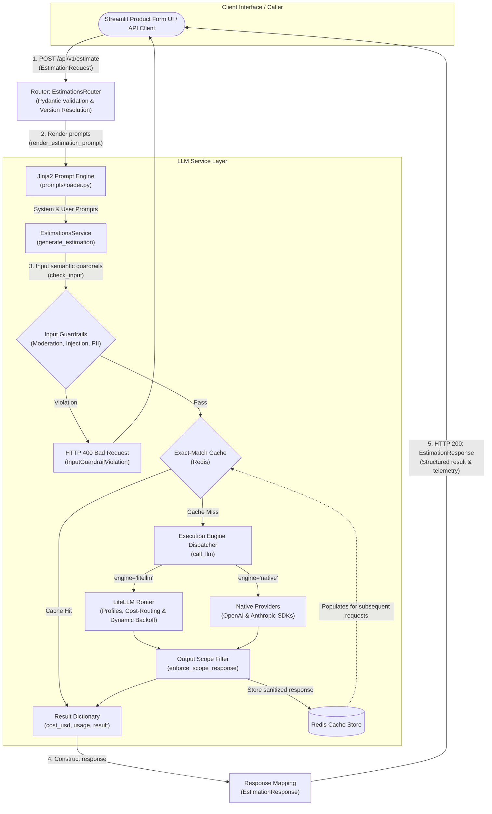
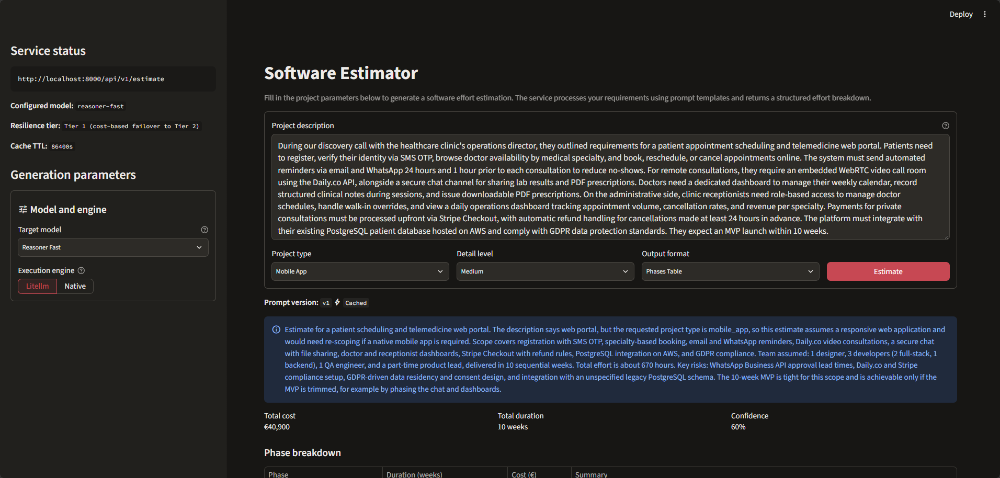
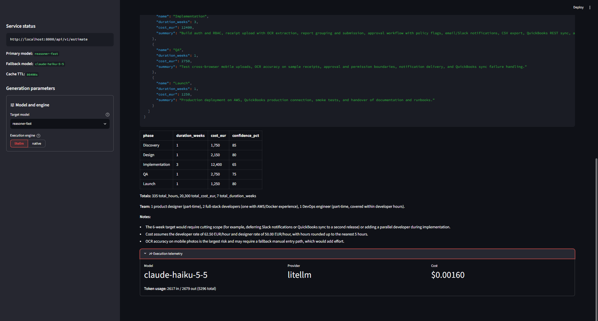

# AIE Estimator

FastAPI backend service for automated software engineering effort estimation using Context-Augmented Generation (CAG) queryable via a structured product form interface based on Streamlit.

## About

This is my personal repository where I am coding the project while following the [LIDR AI Engineering program](https://lidr.notion.site/ai-engineering). It explores production Generative AI: Context-Augmented Generation (CAG), advanced RAG, multi-agent workflows, LLMOps, and evaluation with Python, FastAPI, and leading LLMs, starting with an automated software engineering effort estimator.

## Overview

AIE Estimator processes software project descriptions and domain parameters to generate structured project estimates—including task breakdowns, estimated hours, team compositions, and delivery timelines.

Rather than relying on retrieval-augmented generation (RAG) with vector databases, the service uses a Context-Augmented Generation (CAG) architecture. Historical reference estimations are directly injected into the LLM system prompt as few-shot context, grounding model output in established project patterns with minimal operational complexity.

## Architecture

The project enforces strict separation of concerns across dedicated application layers:

- **Schemas (`src/aie_estimator/schemas`)**: Defines domain data schemas and Pydantic models (`EstimationRequest`, `EstimationResponse`) for request payload validation and response contracts.
- **Routers (`src/aie_estimator/routers/`)**: Defines HTTP routes, endpoint documentation, status codes, and request/response handling.
- **Guardrails (`src/aie_estimator/guardrails/`)**: Enforces defense-in-depth semantic validation across input (`check_input`: OpenAI `omni-moderation-latest`, prompt injection heuristics, and PII heuristics) and output (`enforce_scope_response`: filter policy normalizing low-confidence estimations).
- **Services (`src/aie_estimator/services/`)**: Encapsulates core business logic, CAG prompt assembly, multi-provider LLM dispatch with two-level runtime failover (intra-tier rotation and cross-tier escalation), token cost estimation, and deterministic response caching.
- **Prompts (`src/aie_estimator/prompts/`)**: Stores versioned Jinja2 prompt templates (`system.j2`, `user.j2`, `examples.j2`) and loader for estimation prompt rendering.
- **Settings (`src/aie_estimator/settings.py`)**: Environment-aware configuration and settings management powered by `pydantic-settings`, supporting structured JSON logging, credential isolation via `SecretStr`, and secret synchronization to `os.environ`.
- **Server (`src/aie_estimator/server.py`)**: Centralizes FastAPI application initialization, lifespan event handlers, router registration, and global exception mapping.

### Context-Augmented Generation (CAG) Workflow



## Project Structure

```
aie-estimator/
├── auto/                               # Developer automation scripts (dev.cmd, stl.cmd, dc.cmd, test.cmd, lint.cmd, etc.)
├── docker/                             # Containerization and Compose configurations
├── docs/                               # Architecture and feature guides
├── src/
│   └── aie_estimator/
│       ├── __init__.py
│       ├── __main__.py                 # Application CLI entry point
│       ├── model_catalog.py            # Dynamic model catalog resolution and ModelSpec
│       ├── settings.py                 # Pydantic BaseSettings configuration
│       ├── server.py                   # FastAPI server setup and lifespan handling
│       ├── telemetry.py                # OpenTelemetry TracerProvider and structlog context injection
│       ├── llm_profiles.yml            # LiteLLM router profiles, tiers, and telemetry config
│       ├── .env.example                # Example environment configuration
│       ├── guardrails/                 # Defense-in-depth semantic validation
│       │   ├── __init__.py
│       │   ├── input.py                # Moderation API, prompt injection, and PII heuristics
│       │   └── output.py               # Output scope filter and low-confidence normalization
│       ├── prompts/                    # Jinja2 prompt templates and loader
│       │   ├── __init__.py
│       │   ├── loader.py
│       │   └── estimation/v1/          # Modular prompt components (system, user, examples)
│       ├── schemas/
│       │   ├── __init__.py
│       │   └── estimations.py          # EstimationRequest and EstimationResponse schemas
│       ├── routers/
│       │   ├── __init__.py
│       │   ├── estimations_router.py   # POST /api/v1/estimate endpoint
│       │   └── health_router.py        # GET /health status endpoint
│       ├── services/
│       │   ├── __init__.py
│       │   ├── cache.py                # Deterministic exact-match Redis cache
│       │   ├── estimations_service.py  # Estimation orchestration and multi-engine coordination
│       │   ├── exceptions.py           # Service and provider exception hierarchy
│       │   └── providers/              # Isolated provider integrations and dispatch
│       │       ├── __init__.py         # Providers subpackage re-export facade
│       │       ├── dispatcher.py       # Multi-engine provider dispatch (call_llm)
│       │       ├── formatting.py       # Response normalization across engines
│       │       ├── generation_options.py # GenerationOptions, ProviderMode, ReasoningEffort
│       │       ├── litellm_provider.py # LiteLLM Router integration and model routing
│       │       ├── native_providers.py # Direct SDK dispatch for OpenAI and Anthropic
│       │       └── pricing.py          # Offline pricing table and token cost estimation
│       └── utils/
│           ├── __init__.py
│           └── model_constants.py      # Canonical default model and profile constants
├── tests/                              # Unit and integration test suites
├── .dockerignore
├── .gitignore
├── .gitattributes
├── .pre-commit-config.yaml
├── pyproject.toml                      # Project metadata, dependencies, and tools config
├── README.md                           # Project documentation
├── streamlit_app.py                    # Streamlit structured product estimation interface
└── uv.lock                             # Locked dependency graph
```

## Requirements

- Python >= 3.14
- [`uv`](https://docs.astral.sh/uv/) package manager
- Docker Desktop / Docker Compose (for Redis cache, Arize Phoenix observability, and containerized deployments)
- OpenAI API key (`OPENAI_API_KEY`), Anthropic API key (`ANTHROPIC_API_KEY`), or Gemini API key (`GEMINI_API_KEY`)

## Installation & Setup

1. **Clone the repository:**
   ```bash
   git clone <repository-url>
   cd aie-estimator
   ```

2. **Install dependencies:**
   ```bash
   uv sync
   ```

3. **Configure environment variables:**
   Copy the example environment file to the target environment configuration:
   ```bash
   cp src/aie_estimator/.env.example src/aie_estimator/.env.dev
   ```

    Edit `src/aie_estimator/.env.dev` and configure your API keys:
   ```ini
   APP_ENV=dev
   LOG_LEVEL=INFO
   JSON_LOGGING=false
   ENABLE_FILE_LOGGING=false
   ENABLE_OTEL_TRACING=false
   OTEL_EXPORTER_OTLP_ENDPOINT=http://localhost:4317
   LITELLM_LOCAL_MODEL_COST_MAP=false
   SERVER_HOST=localhost
   SERVER_PORT=8000
   OPENAI_API_KEY=your_openai_api_key_here
   ANTHROPIC_API_KEY=your_anthropic_api_key_here
   LLM_MODEL=reasoner-fast
   REDIS_HOST=localhost
   REDIS_PORT=6379
   CACHE_TTL=86400
   ```

## Running the Application

### 1. Docker Compose Environments

Start the detached Docker Compose services from the project root using `auto\dc.cmd <dev|prod>`:

- **Development (Redis Cache, Redis Insight & Arize Phoenix Observability Stack)**:
  Builds and launches Redis (`localhost:6379`), Redis Insight (UI on `http://localhost:5540`) and Arize Phoenix (UI on `http://localhost:6006`, OTLP on `4317/4318`) using `docker/docker-compose.dev.yml` and `src/aie_estimator/.env.dev`:
  ```cmd
  auto\dc.cmd dev
  ```
  Browse cached estimations (keys `estimation:<sha256>`) in [Redis Insight](https://redis.io/insight/) at `http://localhost:5540`, or via CLI:
  ```cmd
  docker exec -it estimator-redis redis-cli
  KEYS estimation:*
  GET <key>
  TTL <key>
  ```
- **Production (Containerized FastAPI + Redis + Arize Phoenix Stack)**:
  Builds the multi-stage production image (`docker/Dockerfile`) and launches it along with Redis and Arize Phoenix on the production environment using `docker/docker-compose.prod.yml` and `src/aie_estimator/.env.prod`:
  ```cmd
  auto\dc.cmd prod
  ```

### 2. Local Development Services

#### FastAPI Backend Service

Launch the FastAPI backend in the active console:

```cmd
auto\dev.cmd
```

Or directly via `uv`:

```bash
uv run aie-estimator
# or
uv run uvicorn aie_estimator.server:server.app --reload --host localhost --port 8000
```

The API service starts on `http://localhost:8000`.

#### Streamlit Product Estimation Interface

With the FastAPI service running, launch the structured product estimation form in a separate terminal:

```cmd
auto\stl.cmd
```

Or directly via `uv`:

```bash
uv run streamlit run streamlit_app.py
```

The product estimation interface opens in your browser at `http://localhost:8501`:




## API Documentation & Endpoints

Interactive documentation is available at:
- **Swagger UI**: `http://localhost:8000/docs`
- **ReDoc**: `http://localhost:8000/redoc`

### Endpoints Summary

| Method | Endpoint | Description |
| :--- | :--- | :--- |
| `GET` | `/` | Root service status and version information |
| `GET` | `/health` | Health check endpoint returning API operational status |
| `POST` | `/api/v1/estimate` | Generates a structured software project effort estimation from project parameters |

---

### `POST /api/v1/estimate`

Analyzes project requirements and parameters, returning a structured effort estimation breakdown.

#### Request Schema

```json
{
  "description": "Client requires a web platform for customer feedback collection with sentiment analysis and Slack notifications. Target release is 4 weeks.",
  "project_type": "web_saas",
  "detail_level": "medium",
  "output_format": "phases_table",
  "model": "reasoner-fast",
  "engine": "litellm"
}
```

#### Response Schema

```json
{
  "result": {
    "summary": "Customer feedback platform with sentiment analysis and Slack notifications.",
    "confidence_pct": 85,
    "phases": [
      {
        "name": "Design & Specifications",
        "duration_weeks": 1,
        "cost_eur": 2500,
        "summary": "API contracts, UX flows, and integration architecture."
      },
      {
        "name": "Core Backend & Integrations",
        "duration_weeks": 2,
        "cost_eur": 5000,
        "summary": "Webhook API, sentiment pipeline, and Slack notification service."
      },
      {
        "name": "Frontend & Delivery",
        "duration_weeks": 1,
        "cost_eur": 2500,
        "summary": "Management dashboard, end-to-end tests, and deployment pipeline."
      }
    ],
    "total_duration_weeks": 4,
    "total_cost_eur": 10000
  },
  "cached": false,
  "prompt_version": "v1",
  "model": "openai/gpt-6-luna",
  "provider": "litellm",
  "cost_usd": 0.00342,
  "usage": {
    "input_tokens": 1420,
    "output_tokens": 380,
    "total_tokens": 1800,
    "preprocessing_input_tokens": 0,
    "preprocessing_output_tokens": 0
  }
}
```

#### Example cURL

```bash
curl -X POST http://localhost:8000/api/v1/estimate \
  -H "Content-Type: application/json" \
  -d '{
    "description": "In the meeting with the marketing team, the client explained that they need a landing page with a contact form, integration with their existing CRM (HubSpot), and a blog section with a WYSIWYG editor. The target timeline is 4 weeks. Designs already exist in Figma.",
    "project_type": "web_saas",
    "detail_level": "medium",
    "output_format": "phases_table",
    "model": "reasoner-fast",
    "engine": "litellm"
  }'
```

---

### `GET /health`

Verifies that the service is running.

#### Example Response

```json
{
  "status": "healthy",
  "version": "0.1.0"
}
```

## Verification Checklist

Verify local setup against the baseline project criteria:

- [x] Application initializes with `uv run aie-estimator` or `uv run uvicorn aie_estimator.server:server.app --reload`
- [x] API keys and secrets load from `.env.<environment>` via `pydantic-settings` without hardcoded fallbacks
- [x] `GET /health` returns HTTP 200 with `status: healthy`
- [x] `POST /api/v1/estimate` processes project descriptions and parameters to return structured estimations
- [x] Prompts include historical few-shot reference examples from `src/aie_estimator/prompts/estimation/v1/examples.j2`
- [x] Streamlit product form interface accessible at `http://localhost:8501` via `uv run streamlit run streamlit_app.py`
- [x] Redis exact-match cache short-circuits repeated estimation requests with offline fallback
- [x] Redis Insight UI accessible at `http://localhost:5540` showing `estimation:*` cache keys
- [x] Arize Phoenix observability UI accessible at `http://localhost:6006`
- [x] Swagger documentation is accessible at `/docs`
- [x] `.env*` files are excluded in `.gitignore`

## Code Quality & Standards

- **Linter & Formatter**: Configured with `ruff` (line-length 140, Python 3.14 target).
  ```bash
  uv run ruff check .
  uv run ruff format .
  ```
- **Test Suite**: Managed via `pytest`.
  ```bash
  uv run pytest
  ```
- **Pre-commit**: Git hooks configured via `.pre-commit-config.yaml`.
  ```bash
  uv run pre-commit run --all-files
  ```

## Documentation

Detailed architecture guides and technical documentation are maintained in the [`docs/`](docs/) directory:

- [API Schemas & Data Contracts](docs/api-schemas.md): Request and response payload schemas, field validation rules, token accounting, and Level-1 structural evaluation scoring.
- [Prompt Template Engine](docs/prompt-engine.md): Modular Jinja2 prompt composition, system/user template layouts, few-shot examples injection, and decoupled versioning.
- [Guardrails & Semantic Validation](docs/guardrails.md): Multi-layer semantic validation across input (content moderation, prompt injection heuristics, PII scanning) and output (low-confidence normalization).
- [Estimations Service Architecture & Provider Subpackage](docs/estimations-service.md): Deep dive into estimations orchestration, provider isolation, LiteLLM Router, native SDKs, retry backoff, and exception handling.
- [Model Catalog & Request Validation](docs/model-catalog.md): Centralized model catalog, supported OpenAI/Anthropic models, reasoning metadata, and boundary validation.
- [Reasoning Profiles & Dynamic Routing](docs/reasoning-profiles.md): LiteLLM router profiles, qualitative reasoning effort tiers, cost-optimized dynamic fallback, two-level runtime failover, and credential filtering.
- [Structured Product UI & Exact-Match Cache](docs/streamlit-conversational-ui.md): Streamlit product form interface, instant static Markdown rendering, execution telemetry container, deterministic Redis exact-match caching, and graceful degradation.
- [Observability, Logging & Distributed Tracing](docs/observability.md): Unified structlog pipeline, standardized event taxonomy, OpenTelemetry context injection, Arize Phoenix container setup, and DuckDB storage mechanics.
- [Testing Guidelines](docs/testing.md): Test suite organization, pytest fixtures, and coverage expectations.

