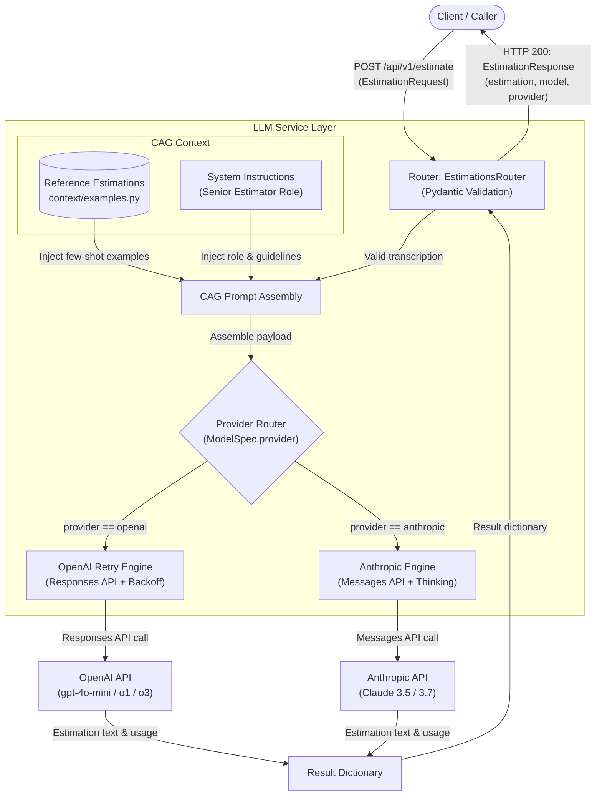

# AIE Estimator

FastAPI backend service for automated software engineering effort estimation using Context-Augmented Generation (CAG).

## Overview

AIE Estimator processes client meeting transcripts and generates structured project estimates—including task breakdowns, estimated hours, team compositions, and delivery timelines.

Rather than relying on retrieval-augmented generation (RAG) with vector databases, the service uses a Context-Augmented Generation (CAG) architecture. Historical reference estimations are directly injected into the LLM system prompt as few-shot context, grounding model output in established project patterns with minimal operational complexity.

## Architecture

The project enforces strict separation of concerns across dedicated application layers:

- **Schemas (`src/aie_estimator/schemas`)**: Defines domain data schemas and Pydantic models (`EstimationRequest`, `EstimationResponse`) for request payload validation and response contracts.
- **Routers (`src/aie_estimator/routers/`)**: Defines HTTP routes, endpoint documentation, status codes, and request/response handling.
- **Services (`src/aie_estimator/services/`)**: Encapsulates business logic and LLM interactions. Assembles the CAG prompt and invokes LLM APIs with retry mechanisms.
- **Context (`src/aie_estimator/context/`)**: Stores static reference datasets and few-shot estimation examples injected into model prompts.
- **Settings (`src/aie_estimator/settings.py`)**: Environment-aware configuration and settings management powered by `pydantic-settings`, supporting structured JSON logging and credential isolation via `SecretStr`.
- **Server (`src/aie_estimator/server.py`)**: Centralizes FastAPI application initialization, lifespan event handlers, router registration, and global exception mapping.

### Context-Augmented Generation (CAG) Workflow



## Project Structure

```
aie-estimator/
├── auto/                               # Developer automation scripts
├── docs/                               # Architecture and feature guides
│   ├── llm-service.md                  # LLM provider integration and error handling
│   ├── logging.md                      # Structlog configuration and conventions
│   └── testing.md                      # Testing guidelines and pytest conventions
├── samples/                            # Sample scripts and testing utilities
├── src/
│   └── aie_estimator/
│       ├── __init__.py
│       ├── __main__.py                 # Application CLI entry point
│       ├── settings.py                 # Pydantic BaseSettings configuration
│       ├── server.py                   # FastAPI server setup and lifespan handling
│       ├── .env.example                # Example environment configuration
│       ├── context/
│       │   ├── __init__.py
│       │   └── examples.py             # Historical few-shot estimation examples
│       ├── schemas/
│       │   ├── __init__.py
│       │   └── estimations.py          # EstimationRequest and EstimationResponse schemas
│       ├── routers/
│       │   ├── __init__.py
│       │   ├── estimations_router.py   # POST /api/v1/estimate endpoint
│       │   └── health_router.py        # GET /health status endpoint
│       └── services/
│           ├── __init__.py
│           └── llm_service.py          # CAG prompt assembly and multi-provider (OpenAI/Anthropic) integration
├── tests/                              # Unit and integration test suites
├── .gitignore
├── pyproject.toml                      # Project metadata, dependencies, and tools config
├── README.md                           # Project documentation
└── uv.lock                             # Locked dependency graph
```

## Requirements

- Python >= 3.14
- [`uv`](https://docs.astral.sh/uv/) package manager
- OpenAI API key (`OPENAI_API_KEY`) and/or Anthropic API key (`ANTHROPIC_API_KEY`)

## Installation & Setup

1. **Clone the repository:**
   ```bash
   git clone <repository-url>
   cd aie-estimator
   ```

2. **Install dependencies:**
   ```bash
   uv sync
   ```

3. **Configure environment variables:**
   Copy the example environment file to the target environment configuration:
   ```bash
   cp src/aie_estimator/.env.example src/aie_estimator/.env.development
   ```

    Edit `src/aie_estimator/.env.development` and configure your API keys:
   ```ini
   APP_ENV=development
   LOG_LEVEL=INFO
   JSON_LOGGING=false
   ENABLE_FILE_LOGGING=false
   SERVER_IP=127.0.0.1
   SERVER_PORT=8000
   OPENAI_API_KEY=your_openai_api_key_here
   ANTHROPIC_API_KEY=your_anthropic_api_key_here
   LLM_MODEL=gpt-4o-mini
   ```

## Running the Application

### Using the Project CLI Entry Point

```bash
uv run aie-estimator
```

### Using Uvicorn Directly with Auto-Reload

```bash
uv run uvicorn aie_estimator.server:server.app --reload --host 127.0.0.1 --port 8000
```

The service starts on `http://127.0.0.1:8000`.

## API Documentation & Endpoints

Interactive documentation is available at:
- **Swagger UI**: `http://127.0.0.1:8000/docs`
- **ReDoc**: `http://127.0.0.1:8000/redoc`

### Endpoints Summary

| Method | Endpoint | Description |
| :--- | :--- | :--- |
| `GET` | `/` | Root service status and version information |
| `GET` | `/health` | Health check endpoint returning API operational status |
| `POST` | `/api/v1/estimate` | Generates a project effort estimation from a meeting transcript |

---

### `POST /api/v1/estimate`

Analyzes meeting transcript text and returns an effort estimation breakdown.

#### Request Schema

```json
{
  "transcription": "Client requires a web platform for customer feedback collection with sentiment analysis and Slack notifications. Target release is 4 weeks."
}
```

#### Response Schema

```json
{
  "estimation": "## Estimation: Customer Feedback Platform\n\n### Task Breakdown:\n1. Backend API & Webhook Ingestion: 30 hours\n2. Sentiment Analysis Pipeline: 25 hours\n3. Slack Notification Integration: 15 hours\n4. Frontend Dashboard: 35 hours\n5. Testing & Deployment: 20 hours\n\n**Total Estimated Hours:** 125 hours\n**Recommended Team:** 2 Full-Stack Developers\n**Estimated Duration:** 3-4 weeks",
  "model": "gpt-4o-mini",
  "provider": "openai"
}
```

#### Example cURL

```bash
curl -X POST http://127.0.0.1:8000/api/v1/estimate \
  -H "Content-Type: application/json" \
  -d '{
    "transcription": "In the meeting with the marketing team, the client explained that they need a landing page with a contact form, integration with their existing CRM (HubSpot), and a blog section with a WYSIWYG editor. The target timeline is 4 weeks. Designs already exist in Figma."
  }'
```

---

### `GET /health`

Verifies that the service is running.

#### Example Response

```json
{
  "status": "healthy",
  "version": "0.1.0"
}
```

## Verification Checklist

Verify local setup against the baseline project criteria:

- [x] Application initializes with `uv run aie-estimator` or `uv run uvicorn aie_estimator.server:server.app --reload`
- [x] API keys and secrets load from `.env.<environment>` via `pydantic-settings` without hardcoded fallbacks
- [x] `GET /health` returns HTTP 200 with `status: healthy`
- [x] `POST /api/v1/estimate` processes transcriptions and returns structured estimations
- [x] Prompts include historical few-shot reference examples from `src/aie_estimator/context/examples.py`
- [x] Swagger documentation is accessible at `/docs`
- [x] `.env*` files are excluded in `.gitignore`

## Code Quality & Standards

- **Linter & Formatter**: Configured with `ruff` (line-length 140, Python 3.14 target).
  ```bash
  uv run ruff check .
  uv run ruff format .
  ```
- **Test Suite**: Managed via `pytest`.
  ```bash
  uv run pytest
  ```
- **Pre-commit**: Git hooks configured via `.pre-commit-config.yaml`.
  ```bash
  uv run pre-commit run --all-files
  ```

## Documentation

Detailed architecture guides and technical documentation are maintained in the [`docs/`](docs/) directory:

- [LLM Service Architecture & Multi-Provider Integration](docs/llm-service.md): Deep dive into OpenAI Responses API, Anthropic Messages API, extended thinking, client lifecycle, retry backoff, and exception handling.
- [Model Catalog & Request Validation](docs/model-catalog.md): Centralized model catalog, supported OpenAI/Anthropic models, reasoning metadata, and boundary validation.
- [Logging Architecture & Structlog](docs/logging.md): Configuration, formatting sinks, processor pipeline, and context variables binding.
- [Testing Guidelines](docs/testing.md): Test suite organization, pytest fixtures, and coverage expectations.

