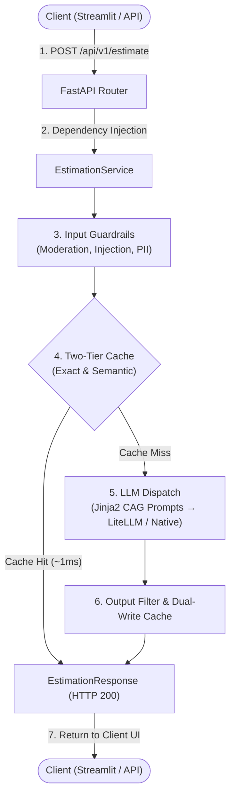

# AIE Estimator

FastAPI backend service for automated software engineering effort estimation using Context-Augmented Generation (CAG), paired with a Streamlit product form interface.

## About

Personal repository following the [LIDR AI Engineering program](https://lidr.notion.site/ai-engineering), exploring production Generative AI: Context-Augmented Generation (CAG), multi-provider LLM routing, guardrails, semantic caching, and observability with Python, FastAPI, and leading LLMs.

## Overview

AIE Estimator processes software project descriptions and domain parameters (`project_type`, `detail_level`, `output_format`) to produce structured effort estimates—task phases, durations, EUR costs, and confidence scores. Historical reference estimations are injected into versioned Jinja2 system prompts as few-shot CAG context, eliminating vector database retrieval for core context assembly.

## Architecture

- **Schemas** ([`src/aie_estimator/schemas/`](src/aie_estimator/schemas/)): Pydantic v2 contracts (`EstimationRequest`, `EstimationResponse`, `EstimationResult`, `CreateSessionResponse`, `SessionInfoResponse`).
- **Sessions** ([`src/aie_estimator/sessions/`](src/aie_estimator/sessions/)): In-memory conversational session store, sliding-window `ConversationHistory`, and 6-field `ProjectMetadata`.
- **Routers** ([`src/aie_estimator/routers/`](src/aie_estimator/routers/)): HTTP routes (`POST /api/v1/estimate`, `POST /api/v1/sessions`, `GET /api/v1/sessions/{session_id}`, `GET /health`, `GET /`).
- **Guardrails** ([`src/aie_estimator/guardrails/`](src/aie_estimator/guardrails/)): Input validation (`omni-moderation-latest`, prompt injection, PII heuristics) and low-confidence output normalization.
- **Services** ([`src/aie_estimator/services/`](src/aie_estimator/services/)): Estimation orchestration, two-tier Redis caching (Tier 1 exact SHA-256, Tier 2 RediSearch vector similarity), and multi-provider dispatch with intra-tier rotation and cross-tier failover.
- **Prompts** ([`src/aie_estimator/prompts/`](src/aie_estimator/prompts/)): Versioned Jinja2 templates (`system.j2`, `user.j2`, `examples.j2`) and loader.
- **Configuration & Composition** ([`settings.py`](src/aie_estimator/settings.py), [`dependencies.py`](src/aie_estimator/dependencies.py), [`server.py`](src/aie_estimator/server.py)): `pydantic-settings` environment management, cached dependency injection factories, and FastAPI application factory (`create_app`).
- **Frontend** ([`streamlit_app.py`](streamlit_app.py)): Structured Streamlit estimation form and telemetry viewer.

### Context-Augmented Generation (CAG) Workflow



## Project Structure

```
aie-estimator/
├── auto/                               # Developer automation scripts (dev.cmd, stl.cmd, dc.cmd, test.cmd, lint.cmd, etc.)
├── docker/                             # Containerization and Compose configurations
├── docs/                               # Architecture and feature guides
├── src/
│   └── aie_estimator/
│       ├── __init__.py
│       ├── __main__.py                 # Application CLI entry point
│       ├── model_catalog.py            # Dynamic model catalog resolution and ModelSpec
│       ├── settings.py                 # Pydantic BaseSettings configuration
│       ├── logging.py                  # Structured logging and stdlib logging bootstrap
│       ├── dependencies.py             # Centralized Composition Root and dependency factories
│       ├── server.py                   # FastAPI application factory and lifespan handling
│       ├── telemetry.py                # OpenTelemetry TracerProvider and structlog context injection
│       ├── llm_profiles.yml            # LiteLLM router profiles, tiers, and telemetry config
│       ├── .env.example                # Example environment configuration
│       ├── guardrails/                 # Defense-in-depth semantic validation
│       ├── prompts/                    # Jinja2 prompt templates and loader
│       │   └── estimation/             # Software Engineering Estimation
│       │       └── v1/                 # Prompt template Version 1
│       ├── schemas/                    # Pydantic request/response contracts
│       ├── sessions/                   # Conversational session state, history window, and store
│       ├── routers/                    # FastAPI HTTP route handlers
│       ├── services/                   # Core business logic, caching, and provider dispatch
│       │   ├── cache/                  # Two-tier Redis response caching (exact & semantic)
│       │   └── providers/              # LiteLLM Router and native SDK integrations
│       └── utils/                      # Canonical model and profile constants
├── tests/                              # Unit and integration test suites
├── .dockerignore
├── .gitignore
├── .gitattributes
├── .pre-commit-config.yaml
├── pyproject.toml                      # Project metadata, dependencies, and tools config
├── README.md                           # Project documentation
├── streamlit_app.py                    # Streamlit structured product estimation interface
└── uv.lock                             # Locked dependency graph
```

## Requirements

- Python >= 3.14 and [`uv`](https://docs.astral.sh/uv/)
- Docker / Docker Compose (for Redis cache, Redis Insight, and Arize Phoenix)
- Provider API keys (`OPENAI_API_KEY`, `ANTHROPIC_API_KEY`, `GEMINI_API_KEY`, etc.)

## Installation & Setup

1. Clone the repository and install dependencies:
   ```bash
   git clone <repository-url>
   cd aie-estimator
   uv sync
   ```

2. Create `src/aie_estimator/.env.dev` from [`src/aie_estimator/.env.example`](src/aie_estimator/.env.example) and configure your API keys and runtime flags (`APP_ENV`, `LLM_MODEL`, `REDIS_HOST`, `ENABLE_OTEL_TRACING`, etc.).

## Running the Application

### Docker Compose Infrastructure

Start infrastructure services from the project root using [`auto/dc.cmd`](auto/dc.cmd):

- **Development** (Redis `:6379`, Redis Insight `:5540`, Arize Phoenix `:6006`, OTLP `:4317`/`4318` via [`docker/docker-compose.dev.yml`](docker/docker-compose.dev.yml)):
  ```cmd
  auto\dc.cmd dev
  ```
- **Production** (Multi-stage FastAPI image + Redis + Arize Phoenix via [`docker/docker-compose.prod.yml`](docker/docker-compose.prod.yml)):
  ```cmd
  auto\dc.cmd prod
  ```

### Local Development Services

Start the FastAPI backend (`http://localhost:8000`) and Streamlit UI (`http://localhost:8501`) in separate terminals:

```bash
# Terminal 1: FastAPI backend (or `auto\dev.cmd`)
uv run aie-estimator

# Terminal 2: Streamlit UI (or `auto\stl.cmd`)
uv run streamlit run streamlit_app.py
```


## API Endpoints

Interactive documentation is available at `http://localhost:8000/docs` (Swagger UI) and `http://localhost:8000/redoc` (ReDoc).

| Method | Endpoint | Description |
| :--- | :--- | :--- |
| `GET` | `/` | Service status and version information |
| `GET` | `/health` | Health check endpoint (`{"status": "healthy", "version": "0.1.0"}`) |
| `POST` | `/api/v1/estimate` | Generates a structured project effort estimation |
| `POST` | `/api/v1/sessions` | Creates a new conversational estimation session (`session_id`) |
| `GET` | `/api/v1/sessions/{session_id}` | Inspects session turn counts, `ProjectMetadata`, and TTL timestamps |

See [API Schemas & Data Contracts](docs/api-schemas.md) for payload contracts and error mappings.

## Code Quality & Standards

- **Lint & Format** ([`pyproject.toml`](pyproject.toml)): `auto\lint.cmd` or:
  ```bash
  uv run ruff check .
  uv run ruff format .
  ```
- **Tests & Coverage**: `auto\test.cmd` (or `uv run pytest --cov-fail-under=85` for the 85% coverage gate; `uv run pytest` for local runs without the gate).
- **Pre-commit** ([`.pre-commit-config.yaml`](.pre-commit-config.yaml)): `uv run pre-commit run --all-files`.

## Documentation

Architecture and feature guides in [`docs/`](docs/):

- [API Schemas & Data Contracts](docs/api-schemas.md): Request/response schemas, validators, and HTTP 400 guardrail contracts.
- [Conversational Sessions](docs/conversational-sessions.md): In-memory session lifecycle, bounded sliding-window history, and `ProjectMetadata` merging.
- [Dependency Injection & App Factory](docs/dependency-injection-and-app-factory.md): Application factory, composition root, and test dependency overrides.
- [Estimations Service & Providers](docs/estimations-service.md): Orchestration, LiteLLM/native dispatch, Instructor extraction, and multi-layer retries.
- [Guardrails & Semantic Validation](docs/guardrails.md): Input moderation/injection/PII checks and output low-confidence normalization.
- [Model Catalog](docs/model-catalog.md): Externalized model registry, logical profiles, and OpenAPI enrichment.
- [Observability](docs/observability.md): Structlog event taxonomy, OpenTelemetry context injection, and Arize Phoenix tracing.
- [Prompt Engine](docs/prompt-engine.md): Versioned Jinja2 templates and decoupled prompt/API versioning.
- [Reasoning Profiles](docs/reasoning-profiles.md): Reasoning effort normalization, two-level failover, and credential pruning.
- [Semantic Response Caching](docs/semantic-response-caching.md): Tier 1 exact SHA-256 cache, Tier 2 RediSearch vector cache, and shadow mode.
- [Streamlit UI](docs/streamlit-conversational-ui.md): Structured product form, headless test isolation, and telemetry inspection.
- [Testing Guidelines](docs/testing.md): Suite layout, shared fixtures, coverage gate, and Windows async execution policy.
