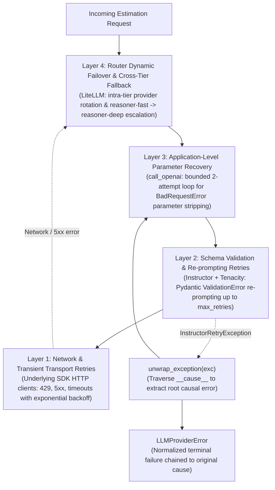

# Estimations Service Architecture and Provider Subpackage

## Overview

`src/aie_estimator/services/estimations_service.py` orchestrates software effort estimations using Context-Augmented Generation (CAG), prompt loading from versioned Jinja2 templates (`prompts/loader.py`), deterministic exact-match Redis caching, and execution delegation to an isolated provider subpackage at `src/aie_estimator/services/providers/`.

Provider execution is divided into two engines:
- **LiteLLM Router (`engine="litellm"`, default)** via `src/aie_estimator/services/providers/litellm_provider.py`: dynamic multi-provider routing across OpenAI, Anthropic, Gemini, Mistral, Scaleway, and Nebius.
- **Native SDKs (`engine="native"`, legacy)** via `src/aie_estimator/services/providers/native_providers.py`: direct vendor SDK calls to the **OpenAI Chat Completions API** and **Anthropic Messages API**.

Unified dispatch across both engines is exposed via `call_llm(user_prompt, system_prompt, opts)` in `src/aie_estimator/services/providers/__init__.py`.

The service architecture is driven by configuration externalized in `src/aie_estimator/llm_profiles.yml`:

| Engine | Routing Target | Dynamic Failover | Cost Tracking (`cost_usd`) | Telemetry Policy |
|:-------|:---------------|:-----------------|:---------------------------|:-----------------|
| **LiteLLM Router** (`engine="litellm"`) | Cost-based routing across OpenAI, Anthropic, Gemini, Mistral, Scaleway, and Nebius | Supported cross-provider and cross-tier | Calculated automatically from provider token pricing (or estimated via fallback) | Strict zero-telemetry (`litellm.telemetry=False`) |
| **Native SDK** (`engine="native"`) | Direct vendor SDK calls to OpenAI or Anthropic | None (single provider) | Estimated via fallback pricing (`services/providers/pricing.py`) | Native vendor SDK defaults |

### Logical Routing Profiles

The service decouples business estimation requirements from specific vendor model IDs by providing logical profiles:
- **`reasoner-fast` (Tier 1)**: Cost-optimized reasoning tier for Phase-1 requirement extraction, standard estimations, and high-throughput workloads (routes across GPT-6 Luna low effort, Gemini Flash Lite low reasoning, Claude Haiku 5.5 adaptive medium, Mistral Small, Scaleway DeepSeek Flash).
- **`reasoner-deep` (Tier 2)**: Deep analytical reasoning tier for complex, contradictory transcripts and architecture risk matrices (routes across GPT-6 Luna high effort, Gemini Flash high reasoning, Claude Sonnet 5.5 adaptive medium, Nebius DeepSeek R2).

For details on parameter normalization and provider mappings, see [docs/reasoning-profiles.md](reasoning-profiles.md).

---

## Usage Examples

### 1. Generate Estimation with `EstimationService`

```python
from aie_estimator.schemas.estimations import EstimationRequest, EstimationResult
from aie_estimator.services.cache import EstimationExactCache
from aie_estimator.services.estimations_service import EstimationService

# Initialize service with explicit cache and optional guardrail collaborators
service = EstimationService(exact_cache=EstimationExactCache())

request = EstimationRequest(
    description="Client needs an e-commerce backend with Stripe integration...",
    project_type="web_app",
    detail_level="medium",
    output_format="phases_table",
    model="reasoner-fast",
    engine="litellm",
)

result = await service.generate_estimation(request)

structured_result: EstimationResult = result["result"]
print(structured_result.summary)
print(structured_result.total_cost_eur)
print(result["cost_usd"])  # e.g. 0.00034
print(result["provider"])  # "litellm" or resolved provider
```

### 2. Dependency Injection in FastAPI Route Handlers

```python
from fastapi import APIRouter, Depends
from aie_estimator.dependencies import get_estimation_service
from aie_estimator.schemas.estimations import EstimationRequest, EstimationResponse
from aie_estimator.services.estimations_service import EstimationService

router = APIRouter(prefix="/api/v1")


@router.post("/estimate", response_model=EstimationResponse)
async def create_estimation(
    request: EstimationRequest,
    service: EstimationService = Depends(get_estimation_service),
) -> EstimationResponse:
    result = await service.generate_estimation(request)
    return EstimationResponse(...)
```

### 4. Direct Provider Dispatch via `call_llm`

```python
from aie_estimator.services.providers import GenerationOptions, call_llm

opts = GenerationOptions(model="reasoner-fast", engine="litellm")
response = await call_llm(
    user_prompt="Estimate this backend API project...",
    system_prompt="You are an expert estimator.",
    opts=opts,
)
print(response["cost_usd"])
```

---

## Technical Considerations

### 1. Isolated Provider Subpackage Architecture
The `src/aie_estimator/services/providers/` subpackage encapsulates all vendor SDK and router integrations:
- `generation_options.py`: Defines `GenerationOptions` with `temperature: float = 0.3`, `max_retries: int = 3`, `effective_model`, and `provider` properties.
- `pricing.py`: Defines static rates in `MODEL_COSTS` and computes cost in USD via `estimate_cost`.
- `dispatcher.py`: Routes provider requests between `litellm` and `native` engines via `call_llm(user_prompt=..., system_prompt=..., opts=...)`.
- `formatting.py`: Provides `format_provider_response` normalizing response dictionaries across all engines, receiving and returning structured `result: EstimationResult`.
- `litellm_provider.py`: Wraps LiteLLM Router with Instructor (`instructor.from_litellm`) to extract validated `EstimationResult` instances, unwrapping causal exceptions with `unwrap_exception` on failure.
- `native_providers.py`: Dispatches direct SDK requests via Instructor (`instructor.from_openai` and `instructor.from_anthropic`) with structured parameter recovery on `BadRequestError` around a single call site (`max_completion_tokens` vs `max_tokens`, `reasoning_effort` vs `temperature`), delegating network retries to the underlying SDK clients and unwrapping causal exceptions via `unwrap_exception`.
- `__init__.py`: Clean re-export facade exposing public provider symbols.

### 2. Structured Extraction and Validation Re-Prompting via Instructor
The service uses `instructor` client wrapping to enforce typed JSON Schema extraction into `EstimationResult`.
- **Autoregressive Field Order**: In `EstimationResult`, narrative fields (`summary`, `confidence_pct`, `phases`) precede aggregate metrics (`total_duration_weeks`, `total_cost_eur`), enabling the LLM's autoregressive generation to ground final sums on preceding phase breakdowns.
- **Model Validators**:
  - `phases_sum_matches_total`: Verifies `total_cost_eur == sum(phase.cost_eur for phase in phases)` and `total_duration_weeks == sum(phase.duration_weeks for phase in phases)`.
  - `low_confidence_requires_out_of_scope_prefix`: Verifies that when `confidence_pct < 30`, `summary` starts with `"Out of scope:"`.
- **Automatic Re-prompting and Exception Unwrapping**: Instructor intercepts Pydantic `ValidationError` exceptions during generation and re-prompts the model up to `max_retries` times with validation error feedback. If validation retries are exhausted or an upstream API error occurs, Instructor wraps the failure in `InstructorRetryException`. Providers call `unwrap_exception(exc)` (`services/exceptions.py`) to peel `InstructorRetryException` and inspect the root cause, enabling deterministic parameter recovery (such as stripping unsupported `temperature` on reasoning models in `call_openai`) and logging root failure reasons before raising `LLMProviderError` chained to the original exception (`from e`).

### 3. Structured Cache Serialization
`estimations_service.py` coordinates cache checks and storage through `EstimationCache`:
- On cache miss, `generate_estimation` calls `call_llm` and validates `EstimationResult`.
- Upon successful validation, the result is serialized into Redis using `result.model_dump(mode="json")`.
- On cache hit, the cached dictionary is validated back into an `EstimationResult` via `EstimationResult.model_validate(cached_entry["result"])`.

### 4. Startup Credential Filtering
When `get_litellm_router()` bootstraps the router singleton from `llm_profiles.yml`, each model's `api_key` environment variable reference (e.g. `os.environ/SCALEWAY_API_KEY`) is inspected. If the environment variable is missing or empty, that model is omitted from the active candidate list. This allows the application to run seamlessly in partial-credential environments (e.g. testing with only `OPENAI_API_KEY`).

### 5. Zero-Telemetry and Parameter Normalization Guardrails
Zero-telemetry is enforced programmatically during router instantiation based on `general_settings` in `llm_profiles.yml`:
```python
litellm.telemetry = False
litellm.drop_params = True
litellm.modify_params = True
```
This guarantees GDPR compliance and ensures unsupported parameters (e.g., passing temperature to reasoning models) are stripped before sending upstream.

### 6. Deterministic Cache Key Integration
`EstimationCache.make_key` computes a SHA-256 digest incorporating `system_prompt`, `user_message`, `model`, `max_tokens`, `reasoning_effort`, and `engine`. This prevents cache collisions between `litellm` and `native` executions as well as between different reasoning intensities.

### 7. Cost Tracking and Fallback Pricing Engine
`format_provider_response` (`src/aie_estimator/services/providers/formatting.py`) handles cost resolution:
- **Upstream Priority**: Dynamic costs returned by LiteLLM Router (`response._hidden_params["response_cost"]`) take precedence.
- **Fallback Calculation**: When `cost_usd is None` (such as direct native SDK invocations or unmetered routes), the service delegates to `estimate_cost(model, input_tokens, output_tokens)` from `src/aie_estimator/services/providers/pricing.py`.
- **Model Identifier Resolution**: `estimate_cost` normalizes vendor-prefixed identifiers (e.g. "openai/gpt-6-luna") matching against `MODEL_COSTS` keys.

### 8. End-to-End Estimation Lifecycle with Semantic Guardrails
`generate_estimation` follows an ordered pipeline that embeds semantic validation before cache lookup and before cache storage:
- **Input Guardrails**: Evaluates `check_input(user_prompt)` against OpenAI `omni-moderation-latest`, prompt injection heuristics, and PII patterns (email, IBAN, credit card, phone). Aborts immediately with `InputGuardrailViolation` (HTTP 400).
- **Exact-Match Cache Lookup**: Computes deterministic SHA-256 key via `EstimationCache.make_key`. Cache hits return immediately with `cache_hit=True`.
- **Provider Dispatch**: Calls `call_llm` to execute structured extraction with Instructor.
- **Output Guardrail Filter**: Enforces `enforce_scope_response`, converting unflagged low-confidence results (`confidence_pct < 30`) into standardized out-of-scope responses (`total_cost_eur=0`, single "Not estimated" phase).
- **Validated Cache Persistence**: Only successfully validated and filtered payloads are persisted to Redis.

For in-depth details on the guardrails architecture, see [docs/guardrails.md](guardrails.md).
- **Unconfigured Models**: If a model is not found in `MODEL_COSTS`, `estimate_cost` returns `None`. The resulting response omits `cost_usd`, and the Streamlit UI displays `Cost: N/A`.

### 8. Runtime Resilience and Engine Comparison

The service provides two distinct execution engines with fundamentally different resilience characteristics:

| Feature / Behavior | LiteLLM Router (`engine="litellm"`) | Native SDKs (`engine="native"`) |
|:-------------------|:-------------------------------------|:--------------------------------|
| **Target Scope** | Multi-provider logical profile (`reasoner-fast`, `reasoner-deep`) | Direct vendor SDK (`gpt-6-luna`, `claude-haiku-5-5`) |
| **Intra-Tier Provider Rotation** | Yes: dynamically rotates across up to 5 healthy providers on 429/5xx/timeout | No: fixed to target provider SDK |
| **Cross-Tier Failover** | Yes: escalates from `reasoner-fast` to `reasoner-deep` on tier exhaustion | No: no secondary fallback provider |
| **Max Network Retries** | Configured via `num_retries: 2` in `llm_profiles.yml` | Jittered exponential retries via SDK clients |
| **Timeout Handling** | Configured per-call timeout (`timeout: 30.0s`) before rotating | SDK client default HTTP timeout |
| **Failure Telemetry** | Emits `litellm_router_call_failed` event with target profile and error type | Emits `provider_call_failed` event with provider and error |
| **Exception Raised** | Wraps failure in `LLMProviderError` | Wraps failure in `LLMProviderError` |

#### Operational Failover Flow (`engine="litellm"`)
1. **Entry**: Request arrives specifying a logical profile (or defaulting to `settings.llm_model = "reasoner-fast"`).
2. **Dynamic Routing**: LiteLLM selects the lowest-cost available provider with valid credentials.
3. **Transient Failure**: If the selected provider returns an HTTP 429 (Rate Limit), 5xx error, or exceeds 30.0s, LiteLLM rotates to the next candidate in `reasoner-fast`.
4. **Tier Escalation**: If all Tier 1 candidates fail after retry limits, LiteLLM triggers `router_settings.fallbacks` and dispatches to `reasoner-deep`.
5. **Termination**: If all Tier 2 candidates also fail, an `LLMProviderError` is raised and caught by `estimations_service.py`, which emits an `estimation_generation_failed` log and surfaces a 502/503 error to the caller.

### 9. Multi-Layer LLM Retry Architecture

The service organizes LLM error handling, parameter recovery, and retries into four distinct, hierarchically decoupled layers:



#### Layer 1: Network and Transient Transport Retries
Handles low-level socket drops, rate limits (HTTP 429), and transient vendor outages (HTTP 5xx) at the HTTP client level:
- **Native OpenAI SDK** (`src/aie_estimator/services/providers/native_providers.py`): Managed by `AsyncOpenAI(api_key=...)` with default SDK exponential backoff retries (`max_retries=2`) via `httpx`.
- **Native Anthropic SDK** (`src/aie_estimator/services/providers/native_providers.py`): Initialized explicitly with `AsyncAnthropic(api_key=..., max_retries=2)` performing jittered backoff on 429/5xx responses.
- **LiteLLM Router Client** (`src/aie_estimator/services/providers/litellm_provider.py`): Configured declaratively via `router_settings.num_retries: 2` and `router_settings.timeout: 30.0` in `src/aie_estimator/llm_profiles.yml`.

#### Layer 2: Schema Validation and Re-prompting (Instructor)
Enforces JSON schema adherence and domain constraints defined on `EstimationResult`:
- **Engine**: Client instances are wrapped using `instructor.from_openai`, `instructor.from_anthropic`, or `instructor.from_litellm`.
- **Validation Re-prompting**: When Pydantic validators fail (such as `phases_sum_matches_total` or `low_confidence_requires_out_of_scope_prefix`), Instructor feeds the validation error back to the LLM within the chat context for up to `opts.max_retries` (default `3`, configurable in `GenerationOptions`).
- **Exception Interception**: Instructor intercepts both validation exhaustion and unhandled vendor exceptions, wrapping them into `instructor.core.InstructorRetryException` with the root causal error preserved in `__cause__`.

#### Layer 3: Application-Level Parameter Recovery
Recovers from deterministic API parameter rejections (such as reasoning model incompatibilities):
- **Call-Site Bounded Loop** (`call_openai`): Executes a 2-attempt loop around a single `client.chat.completions.create_with_completion` call site.
- **Root Cause Unwrapping**: Catches exceptions and invokes `unwrap_exception(e)` from `src/aie_estimator/services/exceptions.py` to inspect the underlying cause.
- **Parameter Stripping and Remapping**:
  - If a `BadRequestError` indicates `temperature` is unsupported, removes `temperature`, emits `provider_temperature_stripped`, and retries.
  - If a `BadRequestError` rejects `max_tokens`, remaps to `max_completion_tokens`, emits `provider_tokens_remapped`, and retries.
- **LiteLLM Normalization**: For `engine="litellm"`, parameter stripping is enforced prior to dispatch using `drop_params: true` and `modify_params: true` in `llm_profiles.yml`.

#### Layer 4: Router Dynamic Failover and Cross-Tier Fallback
Applies exclusively to `engine="litellm"`:
- **Intra-Tier Provider Rotation**: If a provider in a logical profile (e.g. `reasoner-fast`) fails or times out after its `num_retries: 2`, LiteLLM rotates traffic to the next lowest-cost healthy candidate in the profile with valid credentials.
- **Cross-Tier Failover Escalation**: When all Tier 1 candidates are exhausted, LiteLLM triggers `router_settings.fallbacks` (`reasoner-fast -> reasoner-deep`), escalating execution to the frontier reasoning pool.
- **Terminal Error Normalization**: If all candidates fail across both tiers, the provider unwraps the exception via `unwrap_exception`, emits `litellm_router_call_failed`, and raises `LLMProviderError` chained to the original cause (`from e`).

### 10. Semantic Guardrails Execution Pipeline

`estimations_service.generate_estimation` coordinates input semantic validation (`check_input`) and output filtering (`enforce_scope_response`):
1. **Pre-Cache Input Semantic Guardrails**: `await check_input(user_prompt, openai_client=get_moderation_client())` runs before exact-match cache lookup. If moderation flags content, prompt injection is detected, or PII is found, it raises `InputGuardrailViolation(reason=...)` which FastAPI maps to HTTP 400 Bad Request. This prevents malicious prompts or PII from querying or polluting the cache.
2. **Post-Extraction Output Scope Filter**: After `call_llm` returns a validated `EstimationResult`, `enforce_scope_response(structured_result)` normalizes low-confidence estimations (`confidence_pct < 30`) without an explicit out-of-scope summary into a safe placeholder response before writing to cache and returning. For complete architectural details, see [docs/guardrails.md](guardrails.md).


