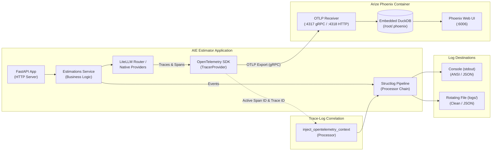

# Observability: Structured Logging, Distributed Tracing, and LLM Telemetry

## Overview

This document defines the observability architecture for `aie-estimator`. The stack combines three core capabilities:

1. **Structured Logging**: Powered by [structlog](https://www.structlog.org/) and bridged to the Python standard library `logging` subsystem to produce machine-readable event streams across console and file sinks.
2. **Standardized Event Taxonomy**: Enforces an explicit `<entity>_<action>_<phase>` convention for all application and domain events.
3. **Distributed Tracing & LLM Observability**: Uses the [OpenTelemetry Python SDK](https://opentelemetry.io/docs/languages/python/) and [OpenInference](https://github.com/Arize-ai/openinference) with [Arize Phoenix](https://docs.arize.com/phoenix) as a self-hosted trace collector, evaluation workbench, and visualization UI backed by an embedded [DuckDB](https://duckdb.org/) columnar database.



---

## Usage Examples

### 1. Declaring a Module Logger

Declare a module-level logger named `log` typed with `Final[structlog.stdlib.BoundLogger]` at the top of the module:

```python
# --- Python Standard Library ---
from typing import Final

# --- Third Party Libraries ---
import structlog

# --- App modules ---

log: Final[structlog.stdlib.BoundLogger] = structlog.get_logger(__name__)
```

### 2. Emitting Standardized Lifecycle Events

All emitted log events follow the `<entity>_<action>_<phase>` taxonomy:

```python
# Phase: started
log.info(
    "estimation_generation_started",
    engine=opts.engine,
    provider=opts.provider,
    model=opts.model,
    description_length=len(user_prompt),
)

# Phase: completed (with latency, token usage, and cost metadata)
log.info(
    "estimation_generation_completed",
    engine=opts.engine,
    provider=opts.provider,
    model=opts.model,
    latency_ms=elapsed_ms,
    cost_usd=response.get("cost_usd"),
    usage=response.get("usage"),
)

# Phase: failed
try:
    result = await call_llm(user_prompt, system_prompt, opts=opts)
except Exception as e:
    log.exception(
        "estimation_generation_failed",
        engine=opts.engine,
        model=opts.model,
        error=repr(e),
        exc_info=e,
    )
    raise
```

### 3. Context Variables Binding

Context variables bound via `structlog.contextvars` automatically attach to all log events within the active asynchronous context:

```python
import structlog

structlog.contextvars.bind_contextvars(request_id="req-6f9a2b1c")
log.info("estimation_request_received")  # Automatically contains request_id="req-6f9a2b1c"
```

### 4. Running Arize Phoenix Locally via Docker Compose

Arize Phoenix runs as an infrastructure service alongside Redis:

```bash
# Start Redis and Phoenix services in the background
docker compose -f docker/docker-compose.dev.yml up -d phoenix redis

# Verify Phoenix health
curl http://localhost:6006/
```

Access the Phoenix web console at `http://localhost:6006` to inspect execution traces, token consumption, latency breakdowns, and prompt/response payloads.

### 5. Enabling OpenTelemetry Tracing

Enable tracing by updating `.env.dev` or exporting environment variables before starting the server:

```ini
ENABLE_OTEL_TRACING=true
OTEL_EXPORTER_OTLP_ENDPOINT=http://localhost:4317
```

When `ENABLE_OTEL_TRACING=true`, the application initializes an OpenTelemetry `TracerProvider`, instruments the FastAPI ASGI app, instruments LiteLLM model invocations via OpenInference, and exports spans over gRPC to the Phoenix collector.

---

## Technical Considerations

### 1. Event Naming Taxonomy (`<entity>_<action>_<phase>`)

All structured log events across the application are normalized to lowercase `snake_case` tokens without trailing periods or sentence punctuation:

| Event Name | Module | Level | Phase / Purpose |
| :--- | :--- | :--- | :--- |
| `estimation_request_received` | `routers/estimations_router.py` | `INFO` | Received incoming HTTP estimation request |
| `estimation_generation_started` | `services/estimations_service.py` | `INFO` | LLM invocation pipeline initiated |
| `estimation_cache_hit` | `services/estimations_service.py` | `INFO` | Response served directly from Redis cache |
| `estimation_generation_completed` | `services/estimations_service.py` | `INFO` | LLM response generated (emits `latency_ms`, `cost_usd`, `usage`) |
| `estimation_generation_failed` | `services/estimations_service.py` | `ERROR` | LLM generation raised an unhandled exception |
| `exact_cache_entry_retrieved` | `services/exact_cache.py` | `INFO` | Key found and deserialized from exact cache store |
| `exact_cache_entry_missed` | `services/exact_cache.py` | `INFO` | Key not found in exact cache store |
| `exact_cache_entry_stored` | `services/exact_cache.py` | `INFO` | Response serialized and stored in exact cache with TTL |
| `exact_cache_deserialization_failed` | `services/exact_cache.py` | `WARNING` | JSON payload deserialization failed from exact cache |
| `exact_cache_lookup_failed` | `services/exact_cache.py` | `WARNING` | Redis exact lookup command failed |
| `exact_cache_store_failed` | `services/exact_cache.py` | `WARNING` | Redis exact store command failed |
| `exact_cache_client_closed` | `services/exact_cache.py` | `INFO` | Redis exact cache client connection closed cleanly |
| `exact_cache_close_failed` | `services/exact_cache.py` | `WARNING` | Redis exact cache client connection close failed |
| `semantic_cache_lookup_evaluated` | `services/semantic_cache.py` | `INFO` | Semantic similarity evaluated against nearest neighbor |
| `semantic_cache_entry_retrieved` | `services/semantic_cache.py` | `INFO` | Nearest neighbor meets or exceeds similarity threshold |
| `semantic_cache_entry_missed` | `services/semantic_cache.py` | `INFO` | Neighbor below threshold or index empty |
| `semantic_cache_hit_log_only` | `services/semantic_cache.py` | `INFO` | Threshold met in shadow log-only mode (bypasses cache hit) |
| `semantic_cache_entry_stored` | `services/semantic_cache.py` | `INFO` | Estimation vector, JSON, and bucket stored in RediSearch |
| `semantic_cache_lookup_failed` | `services/semantic_cache.py` | `WARNING` | RediSearch vector query failed with transient error |
| `semantic_cache_store_failed` | `services/semantic_cache.py` | `WARNING` | Redis semantic store command failed |
| `semantic_cache_client_closed` | `services/semantic_cache.py` | `INFO` | Redis semantic cache client connection closed cleanly |
| `semantic_cache_close_failed` | `services/semantic_cache.py` | `WARNING` | Redis semantic cache client connection close failed |
| `semantic_index_created` | `services/semantic_cache.py` | `INFO` | RediSearch vector index initialized on application startup |
| `semantic_index_exists` | `services/semantic_cache.py` | `DEBUG` | RediSearch vector index already registered |
| `semantic_index_create_failed` | `services/semantic_cache.py` | `WARNING` | RediSearch index initialization failed |
| `semantic_embedding_failed` | `services/semantic_cache.py` | `WARNING` | OpenAI text embedding generation failed |
| `api_startup_initiated` | `server.py` | `INFO` | Lifespan startup sequence begun |
| `api_shutdown_completed` | `server.py` | `INFO` | Lifespan shutdown cleanly finished |
| `database_pool_initialized` | `server.py` | `INFO` | Database connection pool established |
| `database_pool_failed` | `server.py` | `CRITICAL` | Database connection pool failure during startup |
| `database_pool_closed` | `server.py` | `INFO` | Database connection pool closed on shutdown |
| `database_connection_failed` | `server.py` | `ERROR` | Database connection exception during request handling |
| `provider_call_failed` | `server.py`, `services/providers/native_providers.py` | `ERROR` | Upstream provider error captured during invocation or handling |
| `provider_response_received` | `services/providers/native_providers.py` | `INFO` | Successful completion response received from OpenAI or Anthropic SDK |
| `provider_temperature_stripped` | `services/providers/native_providers.py` | `WARNING` | Unsupported temperature parameter stripped on 400 Bad Request |
| `provider_tokens_remapped` | `services/providers/native_providers.py` | `WARNING` | Unsupported max_tokens converted to max_completion_tokens on 400 Bad Request |
| `provider_retries_exhausted` | `services/providers/native_providers.py` | `ERROR` | Retry attempts exhausted for upstream provider |
| `provider_response_truncated` | `services/providers/formatting.py` | `WARNING` | LLM response stopped due to `max_tokens` |
| `litellm_router_call_failed` | `services/providers/litellm_provider.py` | `ERROR` | LiteLLM Router call failed across all candidate models |
| `litellm_response_received` | `services/providers/litellm_provider.py` | `INFO` | Successful completion response received from LiteLLM Router |
| `environment_file_loaded` | `settings.py` | `INFO` | Environment file (`.env.<env>`) successfully read |
| `environment_file_not_found` | `settings.py` | `WARNING` | Environment file missing on startup |

### 2. Trace Context Injection (`inject_opentelemetry_context`)

Correlating structured logs with distributed trace spans is handled in `src/aie_estimator/telemetry.py` via a custom structlog processor:

```python
def inject_opentelemetry_context(
    logger: structlog.types.WrappedLogger,
    method_name: str,
    event_dict: structlog.types.EventDict,
) -> structlog.types.EventDict:
    span = trace.get_current_span()
    span_context = span.get_span_context()
    if span_context.is_valid:
        event_dict["trace_id"] = f"{span_context.trace_id:032x}"
        event_dict["span_id"] = f"{span_context.span_id:016x}"
    return event_dict
```

When an active span exists, `trace_id` (32-character hex) and `span_id` (16-character hex) are injected into the log event dictionary. In JSON log format, these appear as top-level fields; in console format, they render alongside standard key-value pairs. When tracing is disabled or no span is active (`INVALID_SPAN`), the dictionary remains unchanged with zero performance penalty.

### 3. Arize Phoenix Container Architecture

Phoenix is deployed via `docker-compose.dev.yml` and `docker-compose.prod.yml`:

```yaml
phoenix:
  image: arizephoenix/phoenix:latest
  container_name: aie_estimator_phoenix
  restart: unless-stopped
  ports:
    - "6006:6006"   # Web UI and HTTP query API
    - "4317:4317"   # OTLP gRPC collector endpoint
    - "4318:4318"   # OTLP HTTP collector endpoint
  environment:
    - PHOENIX_PORT=6006
    - PHOENIX_GRPC_PORT=4317
    - PHOENIX_ENABLE_PROMETHEUS=false
  volumes:
    - ./volumes/phoenix_data:/root/.phoenix
  networks:
    - estimator-network
```

In production (`docker-compose.prod.yml`), port `6006` is bound strictly to `127.0.0.1:6006:6006` to prevent exposing the unauthenticated UI to public interfaces, requiring an SSH tunnel or reverse proxy with authentication.

### 4. Storage Engine: DuckDB Columnar Mechanics

Arize Phoenix uses an embedded [DuckDB](https://duckdb.org/) database stored inside the container at `/root/.phoenix` (persisted to host directory `./volumes/phoenix_data`).

#### Why DuckDB over PostgreSQL or SQLite for LLM Observability?

| Metric / Feature | DuckDB (Embedded OLAP) | SQLite (Embedded OLTP) | PostgreSQL (External OLTP) |
| :--- | :--- | :--- | :--- |
| **Storage Layout** | Column-oriented (vectorized) | Row-oriented | Row-oriented (tables) |
| **Trace & Span Queries** | Scans only queried attributes (e.g., `latency_ms`, `tokens`) | Reads entire row records from disk | Reads entire rows from disk/shared buffers |
| **JSON/Nested Telemetry** | Native vectorized JSON querying | Text-based JSON functions | JSONB indexing (adds operational overhead) |
| **Operational Footprint** | Embedded in container, 0 extra services | Embedded, single file | Requires dedicated container or host cluster |
| **VPS Resource Usage** | Zero standby CPU/RAM overhead | Low | 150-300 MB baseline RAM |

DuckDB processes analytical queries (filtering spans by model, computing p95/p99 latency quantiles, aggregating token usage over time windows) using vectorized columnar execution kernels without requiring a secondary external relational database cluster on the VPS.

### 5. Formatting Sinks and Renderers

Logging formatting is configured in `Settings.configure_logging()`:

| Environment | Flag | Console Handler (`stdout`) | File Handler (`logs/`) |
| :--- | :--- | :--- | :--- |
| **Development** | `JSON_LOGGING=false` (default) | `ConsoleRenderer(colors=True)` with ANSI | `ConsoleRenderer(colors=False)` (plain text, no ANSI) |
| **Development** | `JSON_LOGGING=true` | `JSONRenderer()` | `JSONRenderer()` |
| **Production** | Any | `JSONRenderer()` | `JSONRenderer()` |
| **Test** | `JSON_LOGGING=false` | `ConsoleRenderer(colors=True)` | `ConsoleRenderer(colors=False)` |

### 6. Lazy Telemetry Loading and Test Isolation

Heavy instrumentation dependencies (`openinference.instrumentation.litellm`, `opentelemetry.instrumentation.fastapi`, `opentelemetry.exporter.otlp`) are imported lazily inside `setup_telemetry()` and `instrument_fastapi_app()`. When `enable_otel_tracing=False` (default in dev, prod, and test environments), these packages are never imported, eliminating background network polling, startup latency, and unmocked loopback network sockets.

### 7. Third-Party Namespace Suppression

Noisy third-party loggers are pinned to `logging.WARNING` in `Settings.configure_logging()`:
- `asyncio`: Suppresses routine event-loop cancellations and selector polling debug lines.
- `psycopg`: Suppresses low-level connection pool state adjustments.
- `uvicorn.error`: Pinned to `logging.WARNING` to suppress informational server lifecycle messages (`Started server process`, `Waiting for application startup`, `Application startup complete`), while retaining genuine runtime errors and crashes.
- `uvicorn.access`: Inherits configured application `log_level` to record incoming HTTP request methods, paths, and status codes.

---

## References

- [OpenTelemetry Python Documentation](https://opentelemetry.io/docs/languages/python/)
- [OpenTelemetry Logs Specification](https://opentelemetry.io/docs/specs/otel/logs/)
- [OpenInference LiteLLM Instrumentation](https://github.com/Arize-ai/openinference/tree/main/python/instrumentation/openinference-instrumentation-litellm)
- [Arize Phoenix Documentation](https://docs.arize.com/phoenix)
- [Structlog Documentation](https://www.structlog.org/)
- [DuckDB Documentation](https://duckdb.org/docs/)

