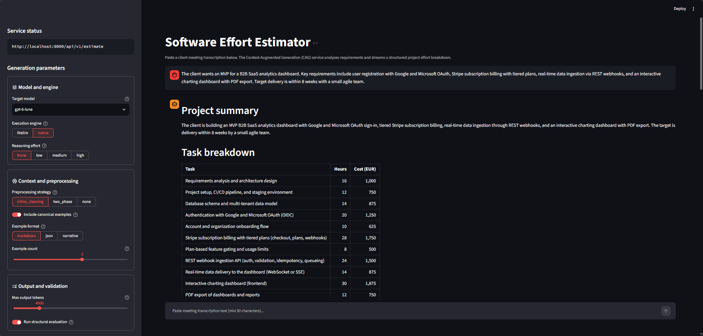

# Conversational UI Wrapper and Exact-Match Caching

## Overview

This document specifies the conversational web interface and exact-match response caching layer implemented in `aie-estimator`.

The conversational interface wrapper provides a web-based Chat UI powered by Streamlit (`streamlit_app.py`). It enables engineers to submit client meeting transcriptions, observe generated software project estimations via simulated real-time streaming, inspect active Context-Augmented Generation (CAG) instructions and reference examples, and track execution metrics across interactions.

Complementing the UI, an exact-match caching layer (`src/aie_estimator/services/cache.py`) backed by Redis short-circuits repeated LLM invocations by returning cached estimations with low latency (~1–3 ms) when identical generation parameters and prompt contents are detected.

---

## Usage Examples

### 1. Launching the Services

#### Option A: Windows Automation Scripts

Start the detached Redis container, the FastAPI backend, and the Streamlit interface from the project root:

```cmd
:: Start the Redis cache container (estimator-redis)
auto\dc.cmd dev

:: Terminal 1: Start FastAPI backend in the current console
auto\dev.cmd

:: Terminal 2: Start Streamlit Conversational Interface in the current console
auto\stl.cmd
```

#### Option B: Direct CLI Commands

Start the FastAPI estimation backend and the Streamlit interface in separate terminals via `uv`:

```bash
# Terminal 1: Start FastAPI backend
uv run aie-estimator
# or: uv run uvicorn aie_estimator.server:server.app --reload --host localhost --port 8000

# Terminal 2: Start Streamlit Conversational Interface
uv run streamlit run streamlit_app.py
```

Streamlit automatically opens the application at `http://localhost:8501`.



### 2. Interactive Meeting Estimation

1. Paste a meeting transcript containing project requirements (minimum 50 characters) into the chat input at the bottom of the screen.
2. The user message appears in the chat transcript.
3. The assistant generates and streams the software effort breakdown word-by-word into the chat view.
4. The conversation remains visible across successive turns, backed by `st.session_state.messages`.

### 3. Generation Parameter Configuration

Open the Streamlit sidebar to customize generation parameters prior to submitting a transcript:

- **Model and Engine (`st.container(border=True)`)**:
  - **Target model**: Dropdown menu dynamically listing models and profiles from `get_supported_models()`, preselecting the application default (`settings.llm_model`).
  - **Execution engine**: Segmented control switching between `litellm` (multi-provider routing) and `native` (legacy direct SDK dispatch).
  - **Reasoning effort**: Segmented control selecting the qualitative reasoning tier (`None`, `low`, `medium`, `high`) for reasoning models.
- **Context and Preprocessing (`st.container(border=True)`)**:
  - **Preprocessing strategy**: Segmented control selecting `inline_cleaning` (appends transcript cleaning instructions to prompt), `two_phase` (executes Phase-1 requirement extraction before estimation), or `none` (raw transcript passed as-is).
  - **Include canonical examples**: Toggle switch enabling or disabling the injection of reference estimations.
  - **Example format**: Segmented control selecting CAG serialization (`markdown`, `json`, or `narrative`), disabled when examples are toggled off.
  - **Example count**: Numeric slider configuring the number of reference examples (0 to 5) injected into the prompt context.
- **Output and Validation (`st.container(border=True)`)**:
  - **Max output tokens**: Slider configuring output generation boundaries (500 to 16,000, step 500).
  - **Run structural evaluation**: Toggle switch enabling Level-1 validation on generated estimation tables, hour totals, costs, team composition, and project duration.

### 4. Inspecting CAG Context and Metrics

The sidebar provides real-time visibility into active prompt context and execution outcomes:

- **Service Status**: Displays the connected backend endpoint URL (`ESTIMATOR_API_BASE_URL`).
- **Active CAG Context**: Expandable panel rendering the live system prompt assembled by `build_system_prompt()`. It dynamically reflects the active `example_format`, `num_examples`, `use_examples`, and `inline_cleaning` settings.
- **Turn-Anchored Execution Details & Evaluation**: Each assistant message in the chat feed retains its full `EstimationResponse` payload, displaying an expandable card containing:
  - Model identifier, upstream provider, response latency, exact-match cache status (`Hit` vs `Miss`), monetary execution cost in USD (`cost_usd`), and provider finish reason.
  - Complete token consumption (`input_tokens`, `output_tokens`, `total_tokens`), including two-phase preprocessing tokens (`preprocessing_input_tokens`, `preprocessing_output_tokens`) when active.
  - Extracted requirements preview when `two_phase` preprocessing was executed.
  - Structural evaluation summary conforming to `StructureCheck`: overall score percentage and status badge, declared vs table-summed hours and cost verification (`hours_match`, `cost_match`), and detected issues list.
- **Clear Chat History**: Resets conversation messages and execution metrics in session state.

### 5. Cache Hit Verification

When an identical transcription is submitted again with the same parameters:
- The backend serves the response directly from Redis.
- The assistant's execution card displays `Cache: Hit` with a response latency under 5 ms and zero additional upstream tokens consumed.

---

## Technical Considerations

### 1. Decoupled HTTP Architecture

`streamlit_app.py` acts strictly as an HTTP client communicating with `POST /api/v1/estimate` using `httpx.AsyncClient` invoked via `asyncio.run()`. The backend router contract and Pydantic validation schemas remain untouched, preventing coupling between UI presentation and core service internals while preparing the client for native Server-Sent Events (SSE) streaming.

### 2. Simulated Progressive Streaming

Because the `POST /api/v1/estimate` endpoint operates without SSE streaming in this stage, `streamlit_app.py` emulates streaming output via `st.write_stream` using a word-level generator with a 10 ms delay:

```python
def simulate_stream(text: str, delay_seconds: float = 0.01) -> Iterator[str]:
    words = text.split(" ")
    for idx, word in enumerate(words):
        yield word if idx == len(words) - 1 else f"{word} "
        time.sleep(delay_seconds)
```

This delivers progressive visual feedback while preparing a drop-in migration path for native Server-Sent Events (SSE) streaming in subsequent stages.

### 3. Deterministic SHA-256 Cache Keying

Cache keys are computed using a SHA-256 hash across all input parameters that affect output generation, including `engine`:

```python
payload = json.dumps(
    {
        "engine": engine,
        "max_tokens": max_tokens,
        "model": model,
        "preprocessing": preprocessing,
        "reasoning_effort": reasoning_effort,
        "system_prompt": system_prompt,
        "user_message": user_message,
    },
    sort_keys=True,
)
cache_key = f"estimation:{hashlib.sha256(payload.encode('utf-8')).hexdigest()}"
```

Because the `system_prompt` string incorporates active instructions, pricing rates, and reference estimation examples, any manual changes to prompt text or CAG context automatically invalidate stale cache keys without manual cache flushing.

### 4. Resilience and Graceful Degradation

Redis operations in `EstimationCache` are non-blocking asynchronous coroutines implemented with `redis.asyncio.Redis` and encapsulated in try/except blocks catching `redis.exceptions.RedisError`. If Redis is offline, unconfigured, or unreachable:
- Asynchronous cache lookups (`await cache.get(key)`) log a warning and return `None` (cache miss).
- Asynchronous cache storage attempts (`await cache.set(key, ...)`) log a warning and return silently.
- Estimation requests complete normally through direct LLM calls without throwing HTTP 500 errors.
- On shutdown, `await cache.close()` cleanly closes the connection pool.

### 5. Environment Configuration & Settings

The cache layer is configured in [src/aie_estimator/settings.py](file:///c:/Development/Repos/ai-engineering/aie-estimator/src/aie_estimator/settings.py) and reads environment variables from `.env.<environment>`:
- `REDIS_HOST`: Redis server host (`localhost` for host development with `docker/docker-compose.dev.yml`, `redis` inside the Docker Compose network for `docker/docker-compose.prod.yml`).
- `REDIS_PORT`: Redis server port (default: `6379`).
- `CACHE_TTL`: Cache entry time-to-live in seconds (default: `86400`).
- `ESTIMATOR_API_BASE_URL`: Streamlit backend target address (default: `http://localhost:8000`).
