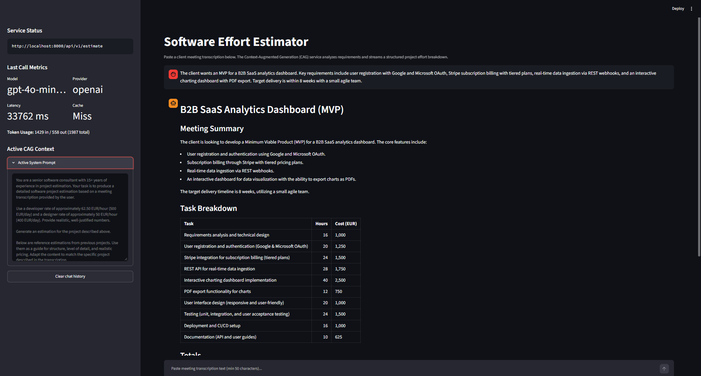

# Conversational UI Wrapper and Exact-Match Caching

## Overview

This document specifies the conversational web interface and exact-match response caching layer implemented in `aie-estimator`.

The conversational interface wrapper provides a web-based Chat UI powered by Streamlit (`streamlit_app.py`). It enables engineers to submit client meeting transcriptions, observe generated software project estimations via simulated real-time streaming, inspect active Context-Augmented Generation (CAG) instructions and reference examples, and track execution metrics across interactions.

Complementing the UI, an exact-match caching layer (`src/aie_estimator/services/cache.py`) backed by Redis short-circuits repeated LLM invocations by returning cached estimations with low latency (~1–3 ms) when identical generation parameters and prompt contents are detected.

---

## Usage Examples

### 1. Launching the Services

#### Option A: Windows Automation Scripts

Start the detached Redis container, the FastAPI backend, and the Streamlit interface from the project root:

```cmd
:: Start the Redis cache container (estimator-redis)
auto\dc.cmd dev

:: Terminal 1: Start FastAPI backend in the current console
auto\dev.cmd

:: Terminal 2: Start Streamlit Conversational Interface in the current console
auto\stl.cmd
```

#### Option B: Direct CLI Commands

Start the FastAPI estimation backend and the Streamlit interface in separate terminals via `uv`:

```bash
# Terminal 1: Start FastAPI backend
uv run aie-estimator
# or: uv run uvicorn aie_estimator.server:server.app --reload --host localhost --port 8000

# Terminal 2: Start Streamlit Conversational Interface
uv run streamlit run streamlit_app.py
```

Streamlit automatically opens the application at `http://localhost:8501`.



### 2. Interactive Meeting Estimation

1. Paste a meeting transcript containing project requirements (minimum 50 characters) into the chat input at the bottom of the screen.
2. The user message appears in the chat transcript.
3. The assistant generates and streams the software effort breakdown word-by-word into the chat view.
4. The conversation remains visible across successive turns, backed by `st.session_state.messages`.

### 3. Inspecting CAG Context and Metrics

Open the Streamlit sidebar on the left:
- **Service Status**: Displays the connected backend endpoint URL (`ESTIMATOR_API_BASE_URL`).
- **Last Call Metrics**: Displays model identifier, provider name, response latency in milliseconds, token breakdown, and cache hit status (`Hit` vs `Miss`).
- **Active CAG Context**: An expandable panel rendering the complete system prompt instructions, consultant role definition, hourly rates, and historical reference examples.
- **Clear Chat History**: Resets session messages and execution metrics.

### 4. Cache Hit Verification

When an identical transcription is submitted again with the same parameters:
- The backend serves the response directly from Redis.
- The sidebar displays `Cache: Hit` with a response latency under 5 ms and zero additional upstream tokens consumed.

---

## Technical Considerations

### 1. Decoupled HTTP Architecture

`streamlit_app.py` acts strictly as an HTTP client communicating with `POST /api/v1/estimate` using `httpx.Client`. The backend router contract and Pydantic validation schemas remain untouched, preventing coupling between UI presentation and core service internals.

### 2. Simulated Progressive Streaming

Because the `POST /api/v1/estimate` endpoint operates synchronously in this stage, `streamlit_app.py` emulates streaming output via `st.write_stream` using a word-level generator with a 10 ms delay:

```python
def simulate_stream(text: str, delay_seconds: float = 0.01) -> Iterator[str]:
    words = text.split(" ")
    for idx, word in enumerate(words):
        yield word if idx == len(words) - 1 else f"{word} "
        time.sleep(delay_seconds)
```

This delivers progressive visual feedback while preparing a drop-in migration path for native Server-Sent Events (SSE) streaming in subsequent stages.

### 3. Deterministic SHA-256 Cache Keying

Cache keys are computed using a SHA-256 hash across all input parameters that affect output generation:

```python
payload = json.dumps(
    {
        "max_tokens": max_tokens,
        "model": model,
        "preprocessing": preprocessing,
        "system_prompt": system_prompt,
        "thinking_budget": thinking_budget,
        "user_message": user_message,
    },
    sort_keys=True,
)
cache_key = f"estimation:{hashlib.sha256(payload.encode('utf-8')).hexdigest()}"
```

Because the `system_prompt` string incorporates active instructions, pricing rates, and reference estimation examples, any manual changes to prompt text or CAG context automatically invalidate stale cache keys without manual cache flushing.

### 4. Resilience and Graceful Degradation

Redis operations in `EstimationCache` are encapsulated in try/except blocks catching `redis.RedisError`. If Redis is offline, unconfigured, or unreachable:
- Cache lookups log a warning and return `None` (cache miss).
- Cache storage attempts log a warning and return silently.
- Estimation requests complete normally through direct LLM calls without throwing HTTP 500 errors.

### 5. Environment Configuration & Settings

The cache layer is configured in [src/aie_estimator/settings.py](file:///c:/Development/Repos/ai-engineering/aie-estimator/src/aie_estimator/settings.py) and reads environment variables from `.env.<environment>`:
- `REDIS_HOST`: Redis server host (`localhost` for host development with `docker/docker-compose.dev.yml`, `redis` inside the Docker Compose network for `docker/docker-compose.prod.yml`).
- `REDIS_PORT`: Redis server port (default: `6379`).
- `CACHE_TTL`: Cache entry time-to-live in seconds (default: `86400`).
- `ESTIMATOR_API_BASE_URL`: Streamlit backend target address (default: `http://localhost:8000`).
